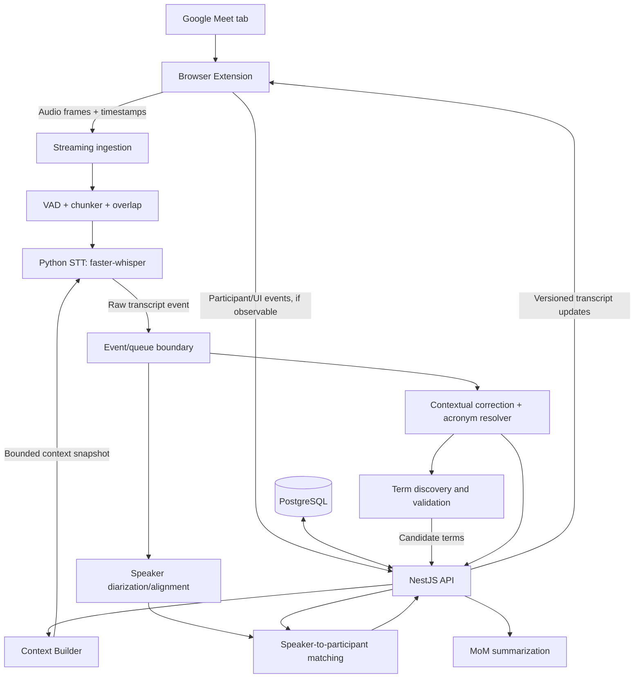

# Context-Aware Transcription Architecture

**Project:** AI-MoM-Summarize-Plugin  
**Status:** Proposed architecture (not an assertion about current source code)  
**Scope:** Google Meet browser extension, NestJS API, Python AI Service, PostgreSQL

## 1. Goals and principles

Build an automation-first meeting transcription system that:

- Automatically discovers meeting participants where Google Meet's accessible UI permits it.
- Improves Vietnamese and mixed Vietnamese–English transcription, proper names, technical vocabulary, and letter-by-letter acronyms (e.g. “M O M” → “MoM”).
- Learns contextual vocabulary over time without requiring users to enter it manually.
- Allows optional workspace/project/meeting context configuration.
- Keeps real-time speech recognition responsive on CPU; performs heavier correction asynchronously.
- Preserves raw audio/transcript evidence and uncertainty rather than fabricating speaker identities or terminology.

**Non-goals for MVP:** guaranteed voice-to-person identification from a single mixed stream; perfect recovery of audio lost by capture/VAD; autonomous glossary updates without quality controls.

## 2. Logical architecture



The diagram is **logical**, not a mandate to deploy each box as a separate microservice. Initially keep one NestJS service, one Python service, and PostgreSQL. Use bounded in-process queues first if sufficient; adopt Redis/other broker when reliability or scale warrants it.

## 3. Service ownership

| Component | Responsibility | Does not guarantee |
|---|---|---|
| Extension | Capture audio, track capture source, attach timestamps, observe participants/active-speaker UI when accessible | Direct access to every remote user's isolated audio |
| NestJS | Auth, tenant/workspace/meeting ownership, participant registry, context snapshots, glossary persistence, transcript versioning, access control | Deriving a person's identity solely from audio |
| Python AI | VAD, streaming STT, diarization, acoustic/linguistic confidence signals, candidate term extraction and correction | Perfect transcript or perfect speaker recognition |
| PostgreSQL | Participants, context, glossary, correction provenance, transcript revisions | Raw high-volume audio storage; use object storage when needed |

## 4. Context model

### 4.1 Context layers

1. **Global/domain:** generic software terms and acronym knowledge (curated or validated).
2. **Tenant/workspace/project:** private terminology, project names, product names, opt-in connected documents.
3. **Meeting static:** title/topic, language, participant display names, user-supplied optional notes.
4. **Meeting dynamic:** recent *confirmed* transcript, detected topic, repeated terms, current conversation segment.

Scope retrieval strictly by tenant and permissions. Assign source, confidence, validity window, and version to every context item.

### 4.2 Context Builder

Inputs: meeting ID, language hint, meeting metadata, participant roster, scoped glossary, latest finalized transcript segments.

Outputs:

```json
{
  "meeting_id": "meet-001",
  "context_version": 12,
  "language_hint": "vi",
  "participants": ["Nguyễn Đặng Hoài Nam", "Trần Minh Anh"],
  "priority_terms": ["MoM", "FastAPI", "WebSocket"],
  "recent_confirmed_text": "Chúng ta cần tổng hợp biên bản cuộc họp.",
  "source_scope": ["workspace", "meeting"]
}
```

Keep prompts short, select only relevant terms, and cap transcript history (e.g. last 1–3 finalized utterances). Never include unconfirmed hallucinated terms as high-priority hints.

## 5. Real-time and intelligence paths

### Fast path (latency sensitive)

1. Capture frames with `meeting_id`, `stream_id`, `seq`, `captured_at`, `sample_rate`, `channels`, `source_kind`.
2. Normalize audio once, validate sample rate/channel layout, preserve timestamps.
3. VAD with speech start/end hysteresis, minimum duration, padding and limited overlap; monitor missed/cut words.
4. Bounded transcription queue; avoid parallel CPU model inference that causes overload.
5. STT with small context prompt; emit `transcript.raw` or provisional text quickly.
6. Persist finalized segments with stable IDs and audio time ranges.

### Slow path (asynchronous)

1. Consume finalized segments.
2. Resolve known acronyms/terms using variants + sentence context + glossary scope.
3. Discover new terminology and produce **candidates**, not unconditional glossary entries.
4. Optionally re-decode suspicious audio spans or invoke LLM correction selectively.
5. Associate speaker clusters with participants only if there is supporting evidence.
6. Emit `transcript.corrected` with revision and provenance; downstream MoM uses latest accepted revision.

The correction queue must not block audio capture, VAD, or STT. Preserve idempotency and event ordering by meeting/segment.

## 6. STT prompt strategy

Example for faster-whisper:

```python
segments, info = model.transcribe(
    audio_chunk,
    language="vi",  # default hint; evaluate multilingual/code-switching behavior
    initial_prompt=(
        "Cuộc họp phần mềm. Người tham gia: Nguyễn Đặng Hoài Nam. "
        "Thuật ngữ liên quan: MoM, FastAPI, WebSocket."
    ),
    condition_on_previous_text=False,
    beam_size=3,
)
```

- `initial_prompt` is a **hint**, not a hard vocabulary constraint.
- `condition_on_previous_text=False` can reduce repetition/hallucination across independently processed chunks; test rather than assume optimality.
- A Vietnamese language hint can bias English letter names. Evaluate mixed-language examples and alternate decoding policies on real recordings.
- On CPU, benchmark model size, quantization, beam size, chunk length and concurrent inference; do not assume GPU is required for context improvements.

## 7. Acronym and terminology intelligence

### Data representation

```json
{
  "canonical": "MoM",
  "expansion": "Minutes of Meeting",
  "domain": "meeting",
  "pronunciation_variants": ["M O M", "em ô em", "em o em"],
  "source": "validated_glossary",
  "confidence": 0.95
}
```

Variants are **observations/candidates**, not universally equivalent strings. In particular `mom` is an ambiguous English word and must not be globally replaced.

### Resolution algorithm

1. Generate candidates using glossary retrieval, lexical/phonetic similarity, and observed ASR confusion patterns.
2. Score against local sentence context, meeting domain, acoustic evidence when available, and glossary reliability.
3. If high confidence, propose a correction; if medium confidence, retain an alternative; if low confidence, preserve raw output.
4. Store original text, suggested text, model/rule version, evidence and confidence.
5. Reuse verified corrections to improve future meeting vocabulary, with tenant isolation.

Avoid `str.replace()` on unbounded text and avoid allowing an LLM to invent names or commitments. For re-decoding, keep the corresponding audio span and only retry when expected quality gain outweighs CPU cost.

## 8. Participant discovery vs speaker identification

These are separate problems:

- **Participant discovery:** detect display names and join/leave events from Google Meet's accessible UI. DOM scraping is brittle; handle missing events and roster reconciliation.
- **Speaker diarization:** segment a mixed recording into anonymous voice clusters (`SPEAKER_00`, etc.). Diarization is uncertain under overlap, short utterances, poor audio and CPU constraints.
- **Speaker identification:** map anonymous clusters to actual participants. Use time-aligned active-speaker UI hints where accessible, consistent repeated evidence, and optional user correction. Do not equate participant list order with speaker order.

Example:

```json
{
  "segment_id": "seg-0042",
  "speaker_cluster_id": "SPEAKER_01",
  "participant_id": null,
  "identity_status": "unresolved",
  "text": "Chúng ta cần gửi MoM sau cuộc họp."
}
```

Only set `participant_id` when evidence supports it. Store confidence and evidence type; offer manual correction as fallback. Do not infer identity from participant names alone.

## 9. Audio capture: unresolved current state and recommendation

**Current implementation is unverified:** it is not yet known whether the extension captures one mixed Meet tab stream, local microphone separately, or both. Inspect the extension's capture APIs and track wiring before selecting a diarization architecture.

### Capture options

| Option | Advantages | Limitations | Recommendation |
|---|---|---|---|
| A. One mixed tab stream | Simple to start; remote conversation may be audible | Cannot reliably map voices to people; local microphone may not be included | Acceptable fallback |
| B. Meet tab audio + separate local mic | Distinguishes local user from remote mix; helps quality and speaker mapping | Clock alignment, echo/double capture, permissions; remote voices still mixed | **Preferred MVP target** |
| C. Per-remote-participant audio tracks | Best potential for speaker separation | Usually not exposed by ordinary tab capture; accessing internal Meet streams is fragile/restricted | Do not assume available |

**Recommended capture design:** two explicitly labeled logical sources (`remote_tab`, `local_mic`), each with monotonic timestamps, sample rate and channel metadata. Keep separate streams for STT and speaker attribution; optionally construct a synchronized mix for playback or summarization. Detect acoustic duplication/echo before merging results. Browser capture permissions, Meet behavior, and user consent must be tested. A tab audio track may already contain multiple remote speakers and is **not** equivalent to per-person tracks.

### Verification checklist

1. Find calls to `chrome.tabCapture`, `chrome.desktopCapture`, `getDisplayMedia`, `getUserMedia`, `AudioContext`, `MediaStreamAudioSourceNode`, and `MediaStreamAudioDestinationNode`.
2. Trace which `MediaStreamTrack`s feed the WebSocket/encoder; label `local_mic` and `remote_tab` if separately available.
3. Check whether audio is mixed in Web Audio, downmixed to mono, or sent as stereo; stereo channels are **not** automatically separate speakers.
4. Record a short consented test: local-only speech, remote-only speech, simultaneous speech, remote joins/leaves.
5. Compare waveform activity per stream and timestamps; confirm no doubled local speech and no missing mic.
6. Measure CPU use, capture-to-transcript latency, VAD cutoffs and dropped chunks.

## 10. Suggested storage schema

- `meetings(id, workspace_id, title, started_at, ended_at, context_version)`
- `meeting_participants(id, meeting_id, external_display_name, joined_at, left_at, identity_source)`
- `audio_streams(id, meeting_id, source_kind, sample_rate, channels, clock_origin)`
- `transcript_segments(id, meeting_id, stream_id, start_ms, end_ms, raw_text, current_revision_id, speaker_cluster_id)`
- `transcript_revisions(id, segment_id, revision_no, text, correction_source, confidence, created_at)`
- `speaker_mappings(id, meeting_id, speaker_cluster_id, participant_id, confidence, evidence_type)`
- `vocabulary_terms(id, workspace_id, canonical, expansion, domain, status, provenance)`
- `vocabulary_variants(id, term_id, surface_form, locale, evidence_count)`
- `context_snapshots(id, meeting_id, version, payload, created_at)`

Enforce tenant/workspace scoping, appropriate uniqueness constraints and retention policies. Raw audio, if retained, should be encrypted in object storage with short configurable retention rather than stored directly as database blobs.

## 11. Event contracts (illustrative)

```json
{
  "event": "transcript.raw",
  "meeting_id": "meet-001",
  "segment_id": "seg-0042",
  "stream_id": "remote_tab",
  "start_ms": 12500,
  "end_ms": 15800,
  "text": "chúng ta cần gửi em ô em",
  "revision": 0,
  "context_version": 12
}
```

```json
{
  "event": "transcript.corrected",
  "meeting_id": "meet-001",
  "segment_id": "seg-0042",
  "revision": 1,
  "text": "Chúng ta cần gửi MoM",
  "correction_source": "acronym_resolver",
  "confidence": 0.91
}
```

The confidence values are illustrative, not calibrated thresholds. Define thresholds empirically with a validation dataset.

## 12. CPU-first implementation plan

### Phase 0 — Audit capture and baseline
- Verify source tracks and mixing path.
- Create consented benchmark clips with Vietnamese, English letter spelling, names, acronyms, interruptions, overlapping speech.
- Measure WER/CER, acronym exact-match, name accuracy, speaker attribution accuracy and p50/p95 latency.

### Phase 1 — Context foundation
- Implement NestJS context/participant/glossary APIs and PostgreSQL persistence.
- Build versioned Context Builder with strict tenant isolation.
- Pass bounded `initial_prompt` to faster-whisper; compare against baseline.

### Phase 2 — Vocabulary and correction
- Implement acronym dictionary, variant candidates and confidence-gated resolver.
- Add revisioned transcripts and correction queue.
- Add validated term discovery with provenance and feedback.

### Phase 3 — Audio and identity
- If feasible, capture separate local mic and remote tab audio.
- Add diarization to remote mix; attempt time-aligned active-speaker matching only where observable.
- Keep unresolved identity explicit; add user correction UX.

### Phase 4 — Selective intelligence
- Add selective audio re-decoding and/or LLM correction.
- Evaluate accuracy gain, hallucinations, privacy, CPU budget and latency before enabling by default.

## 13. Acceptance criteria

- The system transcribes without any manual meeting-context entry.
- User-supplied context improves retrieval but is optional.
- Participant roster updates when accessible; inaccessible metadata is reported as unknown, not invented.
- Acronym correction is measurable on real Vietnamese letter-by-letter utterances.
- Raw transcript is preserved; every correction is traceable and reversible.
- Corrections never block live audio ingestion.
- Uncertain speaker-to-person mapping remains unresolved.
- Tenant vocabulary never leaks into another tenant's prompts.
- CPU benchmark reports latency and quality regressions before release.

## 14. Open decisions

1. **Capture topology:** one mixed stream vs separated local mic + remote tab (verify in current code).
2. Browser permissions and supported Meet versions for participant/active-speaker observation.
3. Target latency and CPU budget; whether correction can arrive seconds later.
4. Whether raw audio is retained for retries, and for how long.
5. Vocabulary validation policy and optional manual review UX.
6. Speaker identity privacy/consent and whether biometric voice profiles are explicitly out of scope.

## 15. Recommended immediate next step

**Audit the extension's audio pipeline first**, then prototype two-source capture (`remote_tab` + `local_mic`) if permissions and actual Meet behavior permit. This is more reliable than designing identity recognition on the assumption that Google Meet exposes per-participant audio. In parallel, Context Builder and Vocabulary Resolver can be developed independently of the final capture topology.
